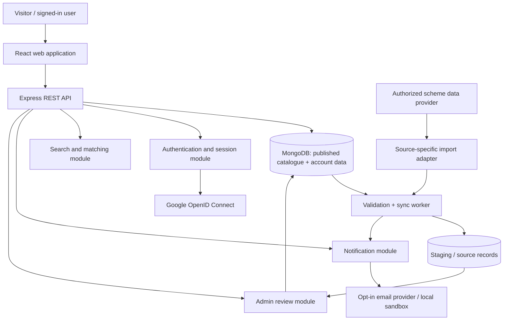
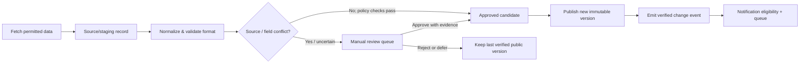
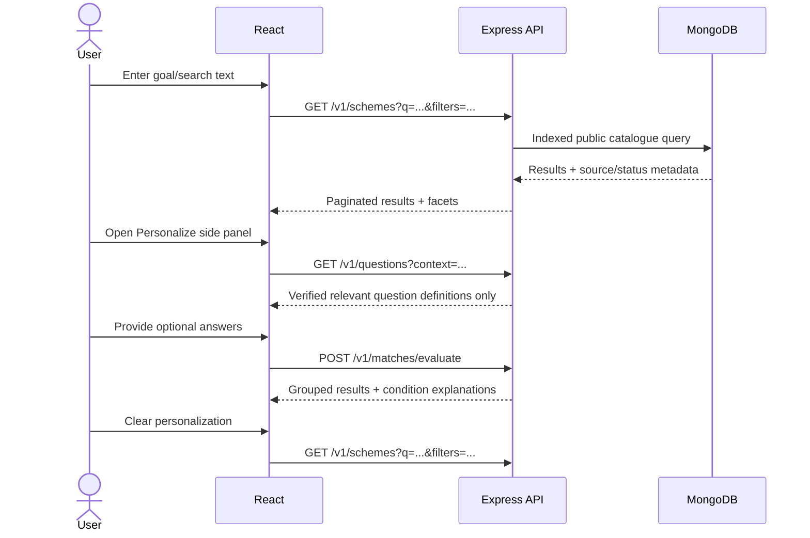

# BenefitBridge — Technical System Design

**Version:** 1.0 | **Date:** 23 November 2026 | **Status:** Proposed architecture; not implemented  
**Companion:** [PRD.md](PRD.md)  
**Implementation style:** Modular MERN monolith with separately runnable worker processes when required; no premature microservices.

## 1. Goals and architecture decisions

- Build a responsive, anonymous-first search product for a potentially large government scheme catalogue.
- Support optional side-panel personalized matching based on **verified** source data.
- Use one authorized provider initially, but isolate provider-specific import logic behind an adapter.
- Keep last verified public data separate from incoming/unreviewed changes.
- Support email/password + Google OIDC, account-based bookmarks, optional saved profiles, and opted-in notifications.
- Defer AI extraction until the core application works; never make live AI calls a dependency of ordinary search.
- Test scale with **synthetic records stored outside the production/real-data database**.
- Do not implement application submission, Aadhaar capture, benefit payments, official eligibility decisions, or unauthorized scraping.

### 1.1 Technology choices

| Layer | Proposed choice | Rationale |
|---|---|---|
| UI | React + Vite + Tailwind CSS | Familiar MERN workflow and modern minimal interface |
| Routing / data | React Router and a query-state client (e.g., TanStack Query) | Shareable search parameters, retries, cache invalidation |
| API | Node.js LTS + Express | One modular, testable REST API |
| Language | JavaScript ES modules, with schema validation and JSDoc | Avoid forcing a TypeScript migration before the user is comfortable; can upgrade later |
| Database | MongoDB (local for development) with Mongoose or official driver | Document-oriented scheme variants and flexible source metadata; explicit indexes |
| Validation | Zod / JSON Schema | Validate requests and imported records; schema validity is not factual verification |
| Authentication | Argon2id password hashing, server-side cookie sessions, Google OpenID Connect | Minimize token exposure to frontend JavaScript; support two identity methods |
| Background work | In-process or separate Node worker for MVP; managed queue + Redis only after demand | Keeps early stack simple; workers scale independently later |
| Search | MongoDB text and compound indexes first | No paid search service required initially; benchmark and revisit relevance quality |
| Email | Local mail sandbox in development, configurable mail provider for optional delivery | Test without unwanted real email traffic or required paid plan |
| Testing | Vitest/Jest, Supertest, React Testing Library, Playwright, k6/Artillery | Unit + integration + E2E + measured load testing |

Named libraries are **implementation recommendations**, not installed dependencies or prerequisites for approval.

## 2. System context and logical architecture

Logical modules are not necessarily independent deployed services. **Initially, one API process plus a locally runnable background worker is enough.** External services can be mocked in offline tests.

### 2.1 Module boundaries

| Module | Owns | Does not own |
|---|---|---|
| Public discovery | Search, facets, sorting, pagination, scheme details | Authentication requirement or official eligibility |
| Matching | Verified question selection, deterministic evaluation, explanations | Inventing missing government rules |
| Identity | Registration, verification, login, Google OIDC, sessions | Government identity verification |
| Account | Saved profile, bookmarks, notification preferences | Guest questionnaire persistence without consent |
| Ingestion | Authorized fetch, snapshots, checkpoints, validation, staging | Direct overwrite of approved public records |
| Review | Publish/reject/dispute decisions, provenance and audit trail | Silently changing a source's contents |
| Notifications | Idempotent events, in-app alerts, email outbox and preferences | Sending messages from ambiguous/unverified updates |
| Administration | Role-based review dashboards and controls | Public scheme application workflow |

## 3. Data design

### 3.1 Design principles

- Separate **source-level facts**, **published catalogue**, and **user-owned data**.
- `sourceId + externalRecordId` is a stable import identity *when the source guarantees that it is stable*; otherwise maintain a mapping and detect identifier changes.
- Preserve raw source payloads/snapshots only to the extent permitted by the provider; always retain allowed source URLs and provenance metadata.
- Scheme facts and rule versions are not overwritten in place when a material update must be auditable.
- Never mix synthetic fixtures with genuine public records: use separate MongoDB databases and distinct environment configuration, e.g., `benefitbridge_dev` and `benefitbridge_loadtest`.
- Prefer references for large version/audit trails; don't place unbounded histories in a single MongoDB document.

### 3.2 Proposed collection inventory

**MVP collections**

| Collection | Essential fields (conceptual) | Notes |
|---|---|---|
| `schemes` | `_id`, `canonicalName`, `description`, `categoryIds[]`, `goalTags[]`, `governmentLevel`, `issuer`, `benefitTypes[]`, `currentVersionId`, `publicationStatus`, `verificationStatus`, `sourceRefs[]`, `lastVerifiedAt`, `lastSyncedAt` | Published searchable catalogue, source-backed fields |
| `scheme_versions` | `schemeId`, `versionNo`, `recordHash`, `effectiveAt?`, `publishedAt`, `fields`, `fieldProvenance`, `reviewDecisionId` | Immutable material revisions; dates may be unknown |
| `sources` | `_id`, `name`, `baseUrl`, `accessPermissions`, `capabilities`, `rateLimits`, `syncPolicy`, `enabled` | One real provider initially; more later |
| `source_records` | `sourceId`, `externalRecordId`, `retrievedAt`, `contentHash`, `payloadOrPermittedReference`, `parseStatus` | Staging/source evidence, may have retention restrictions |
| `review_cases` | `schemeId?`, `sourceRecordIds[]`, `fieldsAffected[]`, `reason`, `status`, `reviewerId?`, `decisionNote?`, `createdAt`, `resolvedAt?` | Conflict and credibility review |
| `users` | `_id`, `email`, `emailVerified`, `passwordHash?`, `roles[]`, `createdAt`, `deletedAt?` | No plaintext passwords; no Aadhaar |
| `auth_identities` | `userId`, `provider`, `providerSubject`, `linkedAt` | Google `sub` is the stable provider identifier |
| `sessions` | `userId`, `sessionIdHash`, `expiresAt`, `revokedAt?` | Server-managed sessions; TTL cleanup |
| `profiles` | `userId`, `attributes`, `consentAt`, `updatedAt` | Encrypted/strictly controlled sensitive fields as appropriate; opt-in storage |
| `bookmarks` | `userId`, `schemeId`, `createdAt` | Unique `(userId, schemeId)` |
| `notification_preferences` | `userId`, `inAppEnabled`, `emailEnabled`, `topics`, `updatedAt` | Consent and channel settings |
| `notifications` | `userId`, `eventKey`, `schemeId`, `type`, `title`, `body`, `readAt?`, `createdAt` | Idempotent in-app alert |
| `email_outbox` | `userId`, `notificationId`, `deliveryKey`, `status`, `attempts`, `nextAttemptAt`, `lastError?` | Retry-safe email workflow |
| `audit_events` | `actorId`, `action`, `entityType`, `entityId`, `beforeHash?`, `afterHash?`, `timestamp` | No raw profile answers in security audit logs |

**Phase 2 collections/fields**

| Collection | Essential fields | Purpose |
|---|---|---|
| `scheme_relationships` | `schemeId`, `relatedSchemeId`, `kind`, `evidenceSourceRef`, `verifiedAt` | Explicit `variant_of`, `supplement_to`, `related_to` |
| `scheme_rule_versions` | `schemeId`, `versionNo`, `rules`, `sourceRef`, `verifiedAt`, `effectiveAt?`, `status` | Independent rule versions for each state variant |
| `question_definitions` | `questionId`, `schemeId`, `ruleRef`, `fieldKey`, `type`, `options?`, `sourceEvidence`, `status` | Dynamically assembled validated questions |
| `sync_jobs` | `sourceId`, `jobId`, `checkpointBefore`, `checkpointAfter`, `startedAt`, `status`, `stats`, `error` | Retry/recovery and reconciliation trace |
| `change_events` | `schemeId`, `versionFrom`, `versionTo`, `fieldsChanged`, `verificationState`, `eventKey` | Matching and notification trigger |
| `saved_match_subscriptions` | `userId`, `scope`, `consentAt`, `lastEvaluatedVersion?` | New matching-scheme alerts |

### 3.3 Suggested indexes

- `schemes`: text index on `canonicalName`, searchable description/keywords; compound indexes on `(publicationStatus, categoryIds)`, `(publicationStatus, governmentLevel)`, `(publicationStatus, stateCodes)` where applicable. Evaluate actual query patterns before creating many indexes.
- `source_records`: unique `(sourceId, externalRecordId, contentHash)` for versions or `(sourceId, externalRecordId)` plus separate revisions; choose based on provider semantics.
- `scheme_versions`: unique `(schemeId, versionNo)`.
- `auth_identities`: unique `(provider, providerSubject)`.
- `users`: unique case-normalized email (and email verification/linking constraints).
- `sessions`: unique session hash and TTL on `expiresAt`.
- `bookmarks`: unique `(userId, schemeId)`.
- `notifications`: unique `(userId, eventKey)` and index `(userId, createdAt)`.
- `email_outbox`: unique `deliveryKey`; index `(status, nextAttemptAt)`.
- `review_cases`: `(status, createdAt)`.

**Search note:** Use bounded page sizes, stable sort keys and limit/offset at MVP scale; consider cursor/keyset pagination at higher volumes. MongoDB basic text search may not handle typos/multilingual relevance well; do not claim production-grade full-text relevance without evaluation.

## 4. Ingestion and lifecycle design

### 4.1 Provider interface (conceptual contract, not code)

An import adapter should declare:
- provider metadata, license/permissions, authentication mechanism, rate limits and retention rules;
- available fetch modes: snapshot, pagination, changed-since/checkpoint, and explicit deletion status if provided;
- record identity/updated timestamps *only if guaranteed by provider*;
- how to parse an item and where to find its official reference URL.

The core pipeline must not assume incremental updates are supported. Initial provider access is unverified.

### 4.2 Pipeline states

**Validation is not synonymous with factual verification.** A well-formed API record can be stale. Where the publisher is trusted for particular fields and update types, policy may allow automatic publishing after consistency checks; conflicting/ambiguous fields require review.

### 4.3 Synchronization strategy (Phase 2)

1. If provider supports incremental sync, fetch changes from the **last committed** checkpoint with a safe overlap window where supported.
2. Stage and deduplicate records; check identity, source timestamps, hashes, and allowed fields.
3. Commit new published versions and checkpoint atomically *or* use a recoverable idempotent checkpoint protocol. MongoDB transactions require an appropriate deployment configuration; do not assume a standalone local MongoDB supports multi-document transactions.
4. Retry transient failures with bounded exponential backoff and rate-limit respect. Repeated failures go to a dead-letter/review queue.
5. Run periodic complete-enough reconciliation to detect missed records; snapshot-only providers rely on full/partial snapshots.
6. Flag missing records only after successful reconciliation plus provider-specific absence policy; explicit official discontinuation is stronger evidence.
7. Keep last verified public data on source outage, displaying stale/verification labels.

### 4.4 Duplicate and relationship handling

- Exact repeated record from the same source: idempotent upsert.
- Similar names across providers/jurisdictions: create *duplicate candidates*, not automatic merges.
- Verified variants link to a parent but retain independent source-backed rule versions.
- Supplemental state scheme and similar independent scheme remain separate, relationship recorded explicitly.

## 5. Search, questionnaire and matching

### 5.1 Search flow

### 5.2 Matching semantics

Input: a bounded set of relevant schemes, questionnaire answers, and **validated structured criteria where available**.

Each mandatory criterion evaluates to:
- `PASS` — sufficient, source-backed answers indicate it is met;
- `FAIL` — sufficient, source-backed answers indicate it is not met;
- `UNKNOWN` — unanswered, unverifiable, complex, contradictory, or unstructured criterion.

Scheme classification:
- **Potential match:** every applicable required structured criterion passed and no known mandatory failure; any essential unstructured/ambiguous criterion moves it to `NEEDS_INFO`.
- **Needs more information:** no known mandatory failure, but at least one essential criterion unknown or absent.
- **Known conditions not met:** at least one verified mandatory criterion failed, subject to source-documented exemptions/alternative conditions.

Rule structures may require AND/OR groups and verified exceptions. **Do not combine criteria through naive numeric averages or percentage scoring.** Matching outcomes are guidance only. If criteria cannot be faithfully modelled, classify as unknown and present source text.

Result ranking: rank primarily by goal/text relevance; within personalization context, potential matches first, unknown next, known-unmet last. All groups remain accessible and filterable. Disputed/stale information displays a warning regardless of rank.

### 5.3 Question-generation approach

**MVP:** Manually verified structured question definitions from permitted source fields; dynamic *selection* of questions based on relevant schemes and known answers.  
**Phase 3:** Offline AI suggests structured questions and citations when records are imported/updated. A validation/review gate must approve them before public use. No per-search live AI requirement.

## 6. Public and authenticated API contract (proposed)

Base: `/api/v1`; JSON, versioned responses, uniform errors `{code, message, details?, requestId}`. Validate and cap query parameters. All results paginate; sensitive endpoints require auth.

### 6.1 Public discovery

| Method & path | Purpose |
|---|---|
| `GET /schemes?q=&goal=&state=&category=&benefitType=&page=&limit=` | Search published catalogue; return result cards, counts/facets where supported |
| `GET /schemes/:schemeId` | Scheme detail, provenance, current status, official links and variants |
| `GET /goals` | List supported goal tags/categories derived from available scheme metadata |
| `GET /facets` | Available categories, states, government levels, benefit types |
| `GET /questions?goal=&schemeIds=` | Obtain verified reusable question definitions relevant to current search |
| `POST /matches/evaluate` | Evaluate guest or signed-in answers ephemerally; return grouped results with explanations |

`POST /matches/evaluate` should limit list size, answers, nesting and request frequency. Do not persist anonymous answers or include them in analytics/error logs.

### 6.2 Identity and personal account

| Method & path | Purpose |
|---|---|
| `POST /auth/register` | Email/password registration; initiate verification |
| `POST /auth/login` | Email/password login |
| `POST /auth/logout` | Invalidate current session |
| `POST /auth/password/forgot` + `POST /auth/password/reset` | One-time, rate-limited recovery tokens |
| `GET /auth/google/start` + `GET /auth/google/callback` | Google OIDC with state/nonce/PKCE as applicable; set app session |
| `GET /me` | Return current account metadata |
| `GET /me/profile`, `PUT /me/profile`, `DELETE /me/profile` | Optional saved questionnaire attributes and consent |
| `GET /me/bookmarks`, `POST /me/bookmarks`, `DELETE /me/bookmarks/:schemeId` | User-owned bookmarked schemes |
| `GET /me/notifications`, `PATCH /me/notifications/:notificationId` | In-app inbox and read status |
| `GET /me/notification-preferences`, `PUT /me/notification-preferences` | In-app/email consent and topic settings |
| `POST /me/export`, `DELETE /me` | Profile/account lifecycle (export may be Phase 2 if not feasible in MVP) |

Never link a Google account to an existing password account solely because email strings match; require safe verification/re-authentication. Do not expose provider tokens to the React app or persist them unless necessary.

### 6.3 Admin and ingestion (protected)

| Method & path | Purpose |
|---|---|
| `GET /admin/reviews?status=` | Review queue |
| `GET /admin/reviews/:id` | Candidate fields, comparison, evidence |
| `POST /admin/reviews/:id/decision` | Approve/reject/defer with audit reason |
| `GET /admin/sources` | Provider capability and last-sync status |
| `POST /admin/sync/:sourceId` | Trigger authorized import (admin-only, rate-limited) |
| `GET /admin/sync-jobs/:id` | Import checkpoint/result/error details |

Internal job triggering may use CLI or authenticated worker coordination instead of public HTTP routes. Admin actions require separate authorization and complete audit trails.

## 7. Authentication, authorization, privacy and security

### 7.1 Identity flow

- Email/password: unique normalized email, verification flow, Argon2id with appropriate parameters, rate-limited login/reset, generic account-enumeration-safe messages.
- Google sign-in: Google Identity Services / OIDC; validate issuer, audience, expiry, nonce and identity token server-side; use provider `sub`, not mutable display name/email, as the identity key. Configure allowed redirect URIs and credentials.
- Session: server-side session store identified by an opaque random HttpOnly, Secure cookie (`SameSite` policy matching deployment), rotation on login and revocation on logout; appropriate CSRF protection when using cookies.
- Roles: `visitor`, `user`, `reviewer`, `admin`; use server-side authorization checks for every private/admin route.
- Development uses local/test credentials; secrets in environment configuration only, never checked into Git.

### 7.2 Data minimization

- Anonymous search should not require registration. Guest answers are transient request data; not persisted, logged or shared with unrelated services.
- Saved profile is explicitly opt-in; support editing/deletion and collection of only necessary scheme attributes.
- Do not collect government ID numbers, bank account details, document uploads, or official login credentials.
- Avoid storing sensitive social-category/disability-related attributes unless truly needed, with clear consent, access limits, deletion, and legal/privacy review before public launch.
- Emails are sent only according to subscribed preferences; provide unsubscribe controls and throttling.
- Sensitive values never appear in URLs, request logs, telemetry, or error messages.

### 7.3 Baseline protections

- HTTPS in public environments; CORS allowlist; rate limiting; secure headers; tight payload caps; validation/escaping for user content.
- CSRF-safe state-changing requests; no hardcoded credentials or leaked access tokens.
- Database user with least privilege; indexes for rate-sensitive endpoints; no unbounded queries.
- Admin activity logs, outbox deduplication, periodic dependency checks, backup/restore exercise before launch.

## 8. Notification subsystem

### 8.1 Supported events

| Event | Initial phase | Preconditions |
|---|---|---|
| Verified material change to bookmarked scheme | MVP | Approved event, bookmarked scheme, opt-in, unique event key |
| Newly discovered potentially relevant scheme from saved profile | Phase 2 | Fresh verified record, valid saved profile, explicit matching-alert consent |
| Uncertain or disputed scheme update | No delivery | Pause affected alerts until conflict resolved |
| Data source outage / unverified missing record | No misleading scheme-alert delivery | Use internal operations alert, optional freshness warning in UI |

### 8.2 Delivery sequence

1. Approved publication creates a durable change event with scheme/version fields.
2. Matcher evaluates subscribed users; ensures event qualifies under rule and consent.
3. Upsert in-app alert by unique `(userId, eventKey)`.
4. Add email outbox record if `emailEnabled` and event type permitted.
5. Worker sends from queue; retry bounded failures, deduplicate delivery, record provider acknowledgement and final state.
6. User can mark read, mute topics, unsubscribe, delete account. Avoid precise eligibility claims in email previews.

For MVP use a basic database-backed outbox and a local SMTP test inbox; phase 2 can adopt a queue service (such as Redis-backed BullMQ) when measured volume justifies it. Do not promise exactly-once email delivery: design for at-least-once processing with idempotency and possible provider duplication.

## 9. Verification states and publication policy

Use **two separate state dimensions**:

- **Scheme lifecycle:** `active`, `closed`, `unknown` (and optional `upcoming`).
- **Information confidence/workflow:** `verified`, `stale`, `under_review`, `disputed`, `unverified`.

Examples: An *active* scheme can have a disputed benefit amount; a *closed* scheme can be fully verified. Avoid a single overloaded status field.

Rules:
- A credible scheme stays discoverable if only individual fields are disputed; disputed values carry warnings.
- A record with unresolved authenticity is quarantined and excluded from public search.
- Disputed material fields do not trigger eligibility-based notifications until resolved.
- On missing-source detection after **complete** reconciliation, mark `under_review`; don't assume closure.
- A source-confirmed discontinuation may produce `closed` after appropriate validation.
- Decisions and source evidence remain auditable.

## 10. Performance and scaling strategy

### 10.1 MVP deployment

- React static frontend (local Vite during development).
- Single Express app process exposing REST API.
- Local MongoDB or a free testing cluster as available.
- Separate Node background job runner may share the same codebase.
- Local email sandbox; controlled Google OAuth test config.

### 10.2 Growth path

1. **Query quality:** Profile real query patterns; add selective compound indexes and query projections; paginate bounded responses.
2. **Search relevance:** Introduce specialized search capabilities only if MongoDB indexes cannot meet measured needs.
3. **Background work:** Split dedicated worker processes, adopt a durable queue when volume warrants it.
4. **Caching:** Cache non-personalized frequently requested search facets and published scheme detail data with explicit invalidation on publication.
5. **Horizontal scaling:** Stateless API behind load balancer; shared session store and queue; connection-pool limits; backpressure on imports.
6. **Observability:** Structured safe logs, request IDs, sync lag, job failures, notifications sent/skipped, queue depth and database latency.

### 10.3 Load-test protocol

- Generate 10k/50k/100k **synthetic** records in a dedicated environment with realistic missing fields, repeated names, state variations and keywords.
- Define a mix of searches, filters and detail reads; add concurrency in stages (e.g. 1, 10, 50, 100 clients).
- Report test machine, MongoDB configuration, dataset seed, exact test script, warm/cold cache, throughput, p50/p95/p99 and error rates.
- **Initial engineering target to test**: p95 < 750 ms for common indexed searches against 50k synthetic records on the declared environment. This is **not a benchmark result**.
- Keep privacy-sensitive guest matching responses out of caching unless appropriately scoped.

## 11. Test strategy and acceptance gates

| Test group | Critical cases |
|---|---|
| Search | Pagination, filters, empty results, stale/closed status, malformed query, index utilization |
| Matching | PASS/FAIL/UNKNOWN, AND/OR, exemption/alternative, no rules, conflicting rule, reset answers |
| Guest privacy | Anonymous answers not persisted or logged; no account required |
| Auth | Password hashing, brute-force controls, Google token validation, unsafe account-link attempt, session logout |
| Authorization | User cannot access another user's profile/bookmarks; reviewer/admin roles enforced |
| Data import | Repeat import, provider timeout, wrong schema, old version, identifier change, source license restrictions |
| Verification | Material conflict holds previous public version; resolved approval publishes new version |
| Missing schemes | Incremental omission ignored; complete reconciliation absence triggers review; official closure handled distinctly |
| Notifications | Consent, duplicate event, retry, unsubscribe, disputed update suppression, account deletion |
| Accessibility | Tab order, labelled inputs, keyboard sidebar, screen-reader alert labels |
| Scale | Reproducible synthetic 50k search benchmark plus failure/load report |

Release gate: **never demonstrate synthetic records as genuine schemes**, never label uncertain eligibility as confirmed, and never claim a government integration without actual authorized access.

## 12. Open risks, assumptions and architecture decision record (ADR)

### 12.1 Risks requiring resolution before real-data integration

| Risk | Decision / mitigation |
|---|---|
| No permitted comprehensive API | Build with a small permitted seed and isolated synthetic load database; retain provider adapter |
| API returns eligibility prose not fields | Show informational eligibility and postpone machine matching until verified extraction |
| Usage/retention restrictions | Source configuration describes permitted fields and snapshot retention, enforced in ingestion |
| Government updates are delayed/missing | Last-verified date, reconciliation, review labels and safe fallback |
| Source record identifiers change | Identity mapping and duplicate review, not silent merge |
| Rules differ by state | Independently versioned rule sets linked to parent only with evidence |
| OAuth provider config | Test project, precise redirect URIs, verified identity linkage |
| Email costs/deliverability | Local mail sandbox first, provider abstraction, opt-in, limits and retries |
| Sensitive saved profiles | Minimal fields, consent, deletion, access restrictions and pre-launch legal review |
| AI errors/costs | Deferred; offline candidates with evidence, review and measurable extraction evaluation |

### 12.2 Assumptions (not verified facts)

- A suitable authorized scheme dataset can be found or compiled for a demonstrable MVP.
- Government data licences may allow a limited snapshot; provider-specific terms must be checked first.
- Initial source count is one; provider-neutral design does not imply multiple connected APIs.
- The MVP is primarily an English-language portfolio demonstration; more languages may follow.
- Host/deployment and email vendor are deliberately not fixed yet.
- The user accepts a modular monolith, not independently deployed microservices, for the first implementation.

### 12.3 ADR summary

| ADR | Decision | Revisit trigger |
|---|---|---|
| ADR-01 | MongoDB local published catalogue, not live external requests per search | Regulatory requirement for source-only access |
| ADR-02 | One provider initially behind replaceable adapter | Additional approved source available |
| ADR-03 | Guest-first; optional questionnaire and identity | Evidence users need identity-first workflow |
| ADR-04 | Independent variants/rule versions and explicit relationships | Verified publisher model simplifies source representation |
| ADR-05 | Hybrid publishing and human conflict review | Measured reviewer bottleneck + reliable source policy |
| ADR-06 | MongoDB text/compound indexes initially | Load/relevance benchmarks justify a search service |
| ADR-07 | Database-backed notifications/outbox in MVP | Throughput and retry load justify dedicated queue |
| ADR-08 | AI-assisted extraction deferred | Stable core product and validated cost/quality case |
| ADR-09 | Server-side secure sessions; Google OIDC | Deployment/session scale needs new store |
| ADR-10 | No claim of verified eligibility or government affiliation | Never; product invariant |

## 13. First engineering handoff to Codex (do not execute yet)

Before writing application code, Codex should receive both specification files and be instructed to:

1. Summarize the MVP boundaries and list unresolved dependencies rather than silently assuming them.
2. Propose a monorepo folder layout with `web`, `api`, optional `worker`, and `docs` directories.
3. Produce a milestone-by-milestone implementation checklist beginning with M1 in the PRD.
4. Design schema validators and initial indexes for the *MVP collection subset*.
5. Keep real authorized fixtures and synthetic scale fixtures physically separated.
6. Request approval **before** implementing, installing packages, making paid calls or contacting external data sources.

This is a **specification handoff**, not a request to generate application code.

## 14. References and official constraints

- myScheme Terms: https://search.myscheme.gov.in/terms-of-use — prohibits unauthorized automated access/scraping.
- API Setu documentation: https://docs.apisetu.gov.in/document-central/explore-apisetu/Overview.html — API marketplace, access depends on publisher authorization.
- API Setu access policy: https://docs.apisetu.gov.in/document-central/explore-apisetu/Partners.html
- Open Government Data India: https://data.gov.in/ — individual dataset applicability and licensing must be confirmed.
- Google OIDC developer guide: https://developers.google.com/identity/openid-connect/openid-connect

*This document does not contain application code and does not claim an operational government API integration.*
